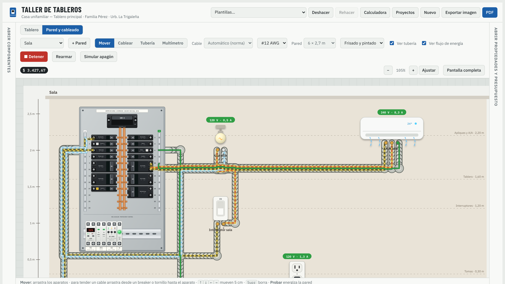

# Taller de Tableros

Aplicación web para **diseñar, cablear, probar y cotizar tableros eléctricos**: cajas de breakers
(120/240 V monofásico y 208Y/120 V trifásico) y tableros sobre riel DIN, con simulador, calculadora
y presupuesto en PDF. Funciona en computadora, tablet y teléfono.



## Contenido del repositorio

| Carpeta | Qué es |
| --- | --- |
| [`app/`](app/) | La aplicación web (HTML, CSS y JavaScript, sin compilación). Ver [app/README.md](app/README.md). |
| [`video/`](video/) | Video publicitario hecho con código ([Remotion](https://www.remotion.dev)) y su voz en off. Ver [video/README.md](video/README.md). |
| [`media/`](media/) | El video final listo para publicar: [`taller-de-tableros-promo.mp4`](media/taller-de-tableros-promo.mp4). |

## Usar la aplicación

No necesita instalación: abre `app/index.html` en el navegador, o sírvela como sitio estático:

```bash
npx serve app
```

Para publicarla basta cualquier hosting estático (GitHub Pages, Cloudflare Pages, Netlify) apuntando a la carpeta `app/`.

## Qué hace

- **Diseña** cajas de breakers y tableros de riel DIN con breakers, diferenciales, contactores,
  relés térmicos, supervisores de voltaje, pulsadores, pilotos, estabilizadores, UPS e inversores.
- **Cablea** una o varias paredes: tomas, interruptores, bombillos, aires, bombas y motores, con
  tubería automática o dibujada a mano y colores y calibres según norma.
- **Prueba** con el simulador: cortocircuitos, sobrecargas, GFCI, mando de motores con retención,
  falta de fase y giro invertido. Muestra el **flujo de energía** animado, lo que recibe cada aparato,
  un **multímetro** y el **diagnóstico** de por qué algo no funciona.
- **Calcula** breaker, cable y caída de tensión; arranque de motores; estabilizador, UPS e inversor
  con baterías; y la demanda completa de una vivienda con su caja de breakers.
- **Cotiza** en $ (y Bs opcional) y genera un PDF profesional con logo, unifilar y cuadro de cargas.
- **Diagrama unifilar** automático de la caja de breakers o del riel DIN, visible en la app y en el PDF.
- **Envía el presupuesto por WhatsApp** (imagen o PDF desde el teléfono, texto desde la computadora). Tus precios quedan guardados para todos los proyectos.

> Herramienta de diseño, enseñanza y presupuesto. No reemplaza el cálculo firmado por un profesional.
